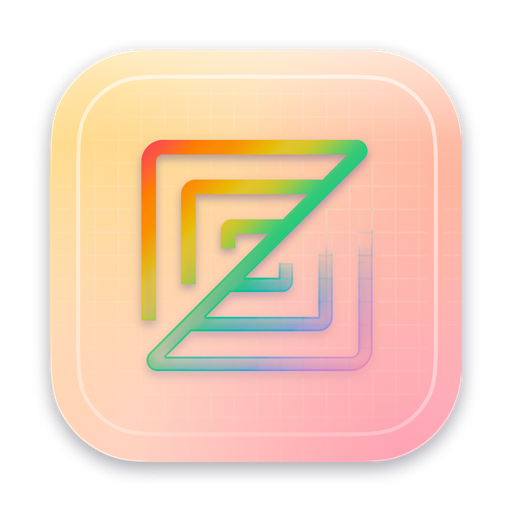
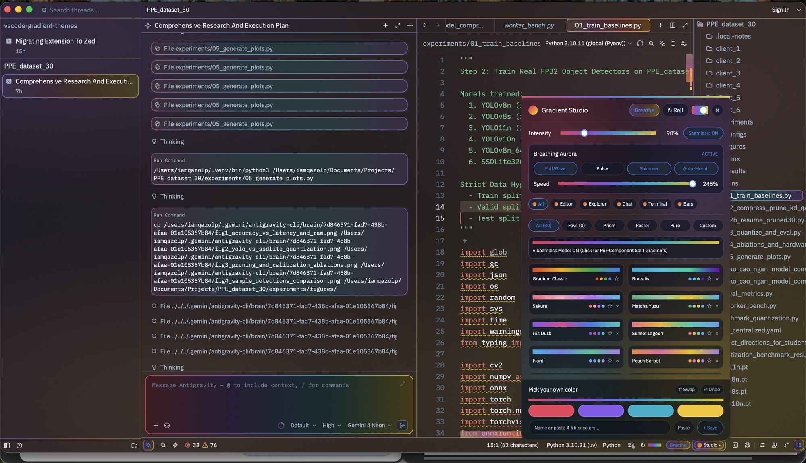
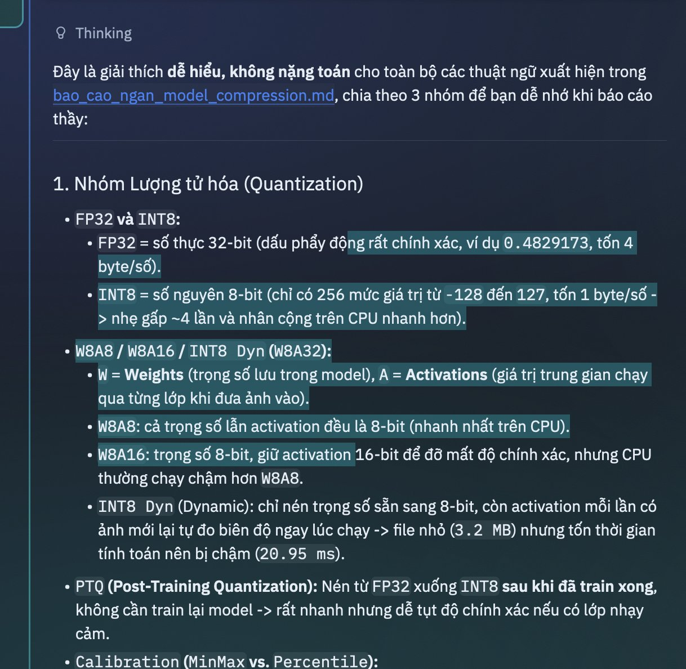

<div align="center">
  
  <h1>Gradient Zed</h1>
  <p>A thin, upstream-tracking fork of <a href="https://github.com/zed-industries/zed">Zed</a> with true GPU-accelerated 4-corner aurora gradients, frosted glass panels, lightweight synchronized Breathing Aurora effects, and an interactive Gradient Studio.</p>
</div>

> See [GRADIENT_ZED.md](./GRADIENT_ZED.md) for Gradient Studio features, keyboard shortcuts, and upstream sync details.

### Screenshots

<p align="center">
  
</p>
<p align="center">
  <sub><strong>Gradient Studio</strong> — live 4-corner aurora backdrop, synced <code>Breathe</code> modes (Full Wave, Pulse, Shimmer, Auto-Morph), 30+ curated &amp; custom palettes, gradient Agent chatbox, and status bar controls.</sub>
</p>

<p align="center">
  
</p>
<p align="center">
  <sub><strong>Agent Chat &amp; Markdown</strong> — frosted rounded gradient cards with 4-stop horizontal gradient text selection.</sub>
</p>

### Gradient Zed macOS Installation (Apple Silicon)

1. Download [`GradientZed-aarch64.dmg`](https://github.com/iamqazolp/gradient-zed/releases/latest/download/GradientZed-aarch64.dmg) and drag **Gradient Zed.app** into `/Applications`.
2. Clear the browser quarantine attribute before first launch (or click **Open Anyway** in **System Settings → Privacy & Security**):
   ```bash
   xattr -cr "/Applications/Gradient Zed.app"
   ```

Or install / update to the latest release in one command:
```bash
curl -fL "https://github.com/iamqazolp/gradient-zed/releases/latest/download/GradientZed-aarch64.dmg" -o /tmp/GradientZed-aarch64.dmg && \
hdiutil attach -nobrowse /tmp/GradientZed-aarch64.dmg -mountroot /tmp && \
rsync -a --delete "/tmp/Gradient Zed/Gradient Zed.app/" "/Applications/Gradient Zed.app/" && \
xattr -cr "/Applications/Gradient Zed.app" && \
hdiutil detach "/tmp/Gradient Zed" && \
rm -f /tmp/GradientZed-aarch64.dmg
```

---

# Zed

[](https://zed.dev)
[](https://github.com/zed-industries/zed/actions/workflows/run_tests.yml)

Welcome to Zed, a high-performance, multiplayer code editor from the creators of [Atom](https://github.com/atom/atom) and [Tree-sitter](https://github.com/tree-sitter/tree-sitter).

---

### Installation

On macOS, Linux, and Windows you can [download Zed directly](https://zed.dev/download) or install Zed via your local package manager ([macOS](https://zed.dev/docs/installation#macos)/[Linux](https://zed.dev/docs/linux#installing-via-a-package-manager)/[Windows](https://zed.dev/docs/windows#package-managers)).

Other platforms are not yet available:

- Web ([tracking discussion](https://github.com/zed-industries/zed/discussions/26195))

### Developing Zed

- [Building Zed for macOS](./docs/src/development/macos.md)
- [Building Zed for Linux](./docs/src/development/linux.md)
- [Building Zed for Windows](./docs/src/development/windows.md)

### Contributing

See [CONTRIBUTING.md](./CONTRIBUTING.md) for ways you can contribute to Zed.

Also... we're hiring! Check out our [jobs](https://zed.dev/jobs) page for open roles.

### Licensing

Zed source code is licensed primarily under GPL-3.0-or-later, with Apache-2.0 components where marked.

License information for third party dependencies must be correctly provided for CI to pass.

We use [`cargo-about`](https://github.com/EmbarkStudios/cargo-about) to automatically comply with open source licenses. If CI is failing, check the following:

- Is it showing a `no license specified` error for a crate you've created? If so, add `publish = false` under `[package]` in your crate's Cargo.toml.
- Is the error `failed to satisfy license requirements` for a dependency? If so, first determine what license the project has and whether this system is sufficient to comply with this license's requirements. If you're unsure, ask a lawyer. Once you've verified that this system is acceptable add the license's SPDX identifier to the `accepted` array in `script/licenses/zed-licenses.toml`.
- Is `cargo-about` unable to find the license for a dependency? If so, add a clarification field at the end of `script/licenses/zed-licenses.toml`, as specified in the [cargo-about book](https://embarkstudios.github.io/cargo-about/cli/generate/config.html#crate-configuration).

## Sponsorship

Zed is developed by **Zed Industries, Inc.**, a for-profit company.

If you’d like to financially support the project, you can do so via GitHub Sponsors.
Sponsorships go directly to Zed Industries and are used as general company revenue.
There are no perks or entitlements associated with sponsorship.
